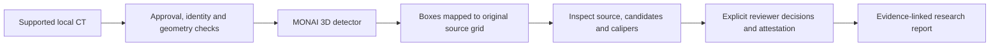

# Local lung nodule research assistant

**v0.10.0 — local 3D CT candidate detection, source-linked annotations, reviewable
measurements and a short human-reviewed research report.** Repository name retained
for continuity: `ai-medimg-2.5D-CT`.

The active detector is a pretrained **MONAI 3D RetinaNet lung nodule model**.
The earlier 2.5D tissue-mask experiment remains a documented engineering baseline
and MHCRA compatibility layer; its Dice and Intel NPU timings are not lung-nodule
results. [What changed](docs/lung/release.md).

**Research only.** This software does not diagnose cancer, exclude disease, issue
management recommendations or replace full CT review. Detector scores are not
malignancy probabilities. Clinical accuracy and time savings have not been
established for this application. No patient data or weights are committed.


The figure uses generated CT-like pixels and an explicitly labeled **non-ML
fixture finder**. It demonstrates software behavior, not pretrained-model accuracy
or a clinician-approved finding. Real pretrained inference has a separate
[executed local smoke record](reports/lung_pretrained_smoke.json).

## What you can do

- Run downloaded, pinned pretrained weights offline on supported CT.
- Inspect source slices and candidate boxes; accept, reject or hold each candidate.
- Place and preview an in-plane caliper and calculate its physical length.
  Detector box extents are never described as lesion diameters or volumes.
- Complete a local reviewer attestation and export an evidence-linked summary.
- Validate research dataset splits and launch the pinned upstream trainer on CUDA.
- Reproduce CPU inference checks and retain the earlier OpenVINO deployment work.

Supported research input is one regular single-frame adult noncontrast chest CT
series, with operator-attested complete coverage. DICOM geometry is checked;
protocol and coverage are not automatically verified. Public research input needs
an explicit approval file. Clinical uploads are unsupported. [Input/data rules](docs/lung/data.md).

## Start locally

Python **3.12**. Reuse `.venv` if present; create it only if absent. Windows uses
`.venv\Scripts\python.exe` wherever `.venv/bin/python` appears below.

```bash
git clone https://github.com/LilyC2024/ai-medimg-2.5D-CT.git
cd ai-medimg-2.5D-CT
python -m venv .venv
# Reference CPU setup: matching torch/torchvision wheels are required.
.venv/bin/python -m pip install torch==2.14.1+cpu torchvision==0.29.1+cpu --index-url https://download.pytorch.org/whl/cpu
.venv/bin/python -m pip install -e ".[ml,lung,ui,dev]"
.venv/bin/python -m pip check
```

For CUDA, install matching CUDA torch/torchvision builds for the actual driver;
do not install the CPU wheels first. Intel NPU is not CUDA training hardware.
[Hardware setup](docs/lung/deployment.md).

**Try the complete review workflow without downloading weights:**

```bash
.venv/bin/python -m lung_nodule.cli demo --output artifacts/lung-demo
.venv/bin/python -m streamlit run src/lung_nodule/ui.py --server.address 127.0.0.1 --server.port 8502
```

Open `http://127.0.0.1:8502`; the default workspace is
`artifacts/lung-demo/workspace`. This deterministic fixture demo leaves review
pending. It is not trained detection. [Review walkthrough](docs/lung/review.md).

**Run actual pretrained inference on that generated CT:**

```bash
# Explicit setup-only download of official weights, recipe, training code and licenses.
.venv/bin/python -m lung_nodule.cli fetch-model --output models/luna16
# Use a new output directory for every inference run.
.venv/bin/python -m lung_nodule.cli detect --series artifacts/lung-demo/series --model-dir models/luna16 --device cpu --patient-alias synthetic --study-id pretrained-demo --output artifacts/pretrained-demo
```

Set the UI workspace to `artifacts/pretrained-demo`. For approved public research
DICOM add `--approval path/to/research-approval.json`. Use `--device cuda` only on
an available CUDA GPU. Unavailable devices fail without silent fallback. No
weights or data download during inference.

## How it works



Python preserves source identity, transforms coordinates and calculates distances.
Report text is a deterministic template. **No LLM reads pixels, invents findings or
approves the report.** An LLM is unnecessary for the short report in this release.
[Architecture](docs/lung/architecture.md).

MHCRA is a separate local history application. Its four runtime specialists and
safety/clinician gates are unchanged. MHCRA v0.2 now consumes **mhcra-lung-nodules-v2**, including source HU,
every-slice annotations and reviewable calipers. Authenticated MHCRA imaging
acceptance and final clinical approval remain separate. The existing synthetic
`mhcra-imaging-v1` tissue-mask bridge stays available. Incomplete nodule-v1
archives need re-export; they cannot be relabeled as tissue masks. [Integration boundary and migration](docs/lung/mhcra.md).

## Verify and reproduce

```bash
.venv/bin/python scripts/check.py
.venv/bin/python scripts/smoke_lung.py --output artifacts/fixture-smoke.json
.venv/bin/python scripts/smoke_lung.py --model-dir models/luna16 --device cpu --output artifacts/pretrained-smoke.json
.venv/bin/python scripts/lung_hardware.py --output artifacts/hardware.json
```

Tests use generated CT and scripted review attestations. Pretrained inference is
recorded separately. GPU training and new-detector NPU inference were not executed
on the CPU-only development host. Historical benchmarks and phantom success do not
demonstrate clinical detection performance. [Actual evaluation](EVALUATION.md).

Current compatibility checks: **81 CT tests** plus companion regression, actual
fixture/pretrained/legacy producer-consumer smokes and local Ollama smoke. See
[EVALUATION.md](EVALUATION.md) for current outcomes and previous hosted checks.

## Documentation and project map

| Need | Detailed guide |
| --- | --- |
| Supported DICOM, approvals, datasets and licenses | [Data](docs/lung/data.md) |
| Source inspection, calipers, approval and export | [Review](docs/lung/review.md) |
| Model, coordinates and trust boundaries | [Architecture](docs/lung/architecture.md) |
| Preparation, CUDA training and detection metrics | [Training/evaluation](docs/lung/training.md) |
| CPU/CUDA/Intel NPU, latency, Docker, troubleshooting | [Deployment](docs/lung/deployment.md) |
| Functions, classes, modules and folders | [Code reference](docs/lung/code-reference.md) |
| MHCRA compatibility and the nodule exchange | [Integration](docs/lung/mhcra.md) |
| Changes, removals and defensible CV descriptions | [Release record](docs/lung/release.md) |
| Old U-Net, ONNX parity and measured Intel NPU work | [Legacy pipeline](docs/legacy-pipeline.md) |

[Full documentation index](docs/README.md) · [Model card](docs/lung/model-card.md) ·
[Phase gates](PLAN.md) · [MIT code license](LICENSE) ·
[Upstream model](https://github.com/Project-MONAI/model-zoo/tree/dev/models/lung_nodule_ct_detection)
