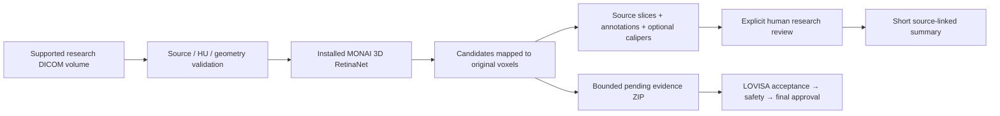
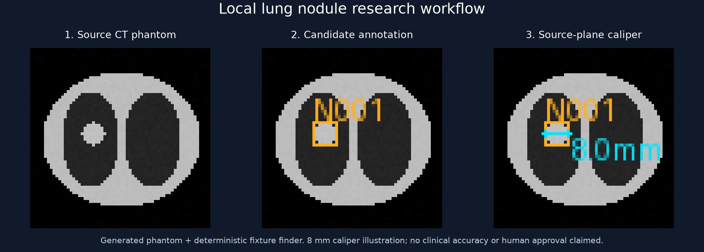

# Lung CT Research Assistant

**Local lung-nodule candidates, source-linked annotations and reviewable
measurements.** This project processes supported research CT volumes, preserves
source geometry, and prepares a short report after explicit human review. It is
the CT companion to [LOVISA](https://github.com/LilyC2024/Medical-AI).

## From volume to reviewed evidence



The model proposes locations, not cancer diagnoses. Boxes are source-grid spans;
calipers are reviewer-selected physical distances. CT processing has **no LLM**.
LOVISA keeps its fictional-history reasoning separate from accepted CT and
[endoscopy](https://github.com/LilyC2024/AI-MedImg-Endo) evidence.



This figure uses generated pixels and a non-ML fixture. Its measurement illustrates
software behavior, not clinical accuracy or pretrained-model performance.

## Run locally

Use Python **3.12** and a separate environment. Reuse `.venv` when present; for a
fresh Linux checkout:

```bash
git clone https://github.com/LilyC2024/ai-medimg-2.5D-CT.git
cd ai-medimg-2.5D-CT
python3.12 -m venv .venv
.venv/bin/python -m pip install torch==2.14.1+cpu torchvision==0.29.1+cpu --index-url https://download.pytorch.org/whl/cpu
.venv/bin/python -m pip install -e '.[ml,lung,ui,dev]'
.venv/bin/python -m lung_nodule.cli demo --output artifacts/first-example
.venv/bin/python -m streamlit run src/lung_nodule/ui.py --server.address=127.0.0.1 --server.port=8502
```

Open `artifacts/first-example/workspace` in the UI. The fixture needs no weights.
Pretrained detection needs an explicitly installed, verified MONAI bundle.
[Full setup, Windows and devices](docs/setup.md) · [Review walkthrough](docs/lung/review.md).

## Connect to LOVISA

Create a companion review ZIP, then use **CT review → Upload → Analyze** in
LOVISA. Analyze validates the ZIP's included source/results; it does not rerun a
full DICOM scan. Inspect all candidates and include the study before safety
assessment and final report approval. Public evidence requires separate provenance
and a fictional composite case. [Integration commands and schemas](docs/lung/mhcra.md).

## Read next

| Guide | Detail |
| --- | --- |
| [Documentation index](docs/README.md) | Choose setup, operation or implementation guides |
| [Architecture](docs/lung/architecture.md) / [Code reference](docs/lung/code-reference.md) | Geometry, modules, functions and persistence |
| [Training](docs/lung/training.md) / [Data](docs/lung/data.md) | Permissions, patient-separated manifests, CUDA training and FROC |
| [Model card](docs/lung/model-card.md) / [Evaluation](EVALUATION.md) | Executed experiments and limits |
| [Validation](docs/validation.md) / [Expert review](docs/review.md) | Reproduce checks and repaired bugs |
| [Legacy 2.5D pipeline](docs/legacy-pipeline.md) | Retained segmentation, ONNX/OpenVINO and historical NPU work |

CPU inference is supported. Full RetinaNet training requires CUDA; the new
detector has no validated NPU path. Historical 2.5D segmentation/NPU experiments
remain separate from lung-nodule performance. [Hardware](docs/lung/deployment.md).

**Research only:** candidates cannot establish malignancy or a normal scan.
No independent clinical validation is claimed. Code is MIT; model/data rights are
separate ([DATA_TERMS](DATA_TERMS.md)). [Security](SECURITY.md) · [Contributing](CONTRIBUTING.md).
