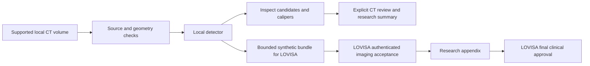

# Lung CT Research Assistant

**Local lung-nodule candidates, source annotations, reviewable measurements and a
brief evidence-linked research report.** Version 0.10.0; repository name:
`ai-medimg-2.5D-CT`.

This project applies pretrained **MONAI 3D RetinaNet** to supported volumetric CT.
A reviewer inspects source slices, accepts/rejects candidates and may place an
in-plane caliper. Python preserves geometry and composes the short report.
It is a research assistant, not a cancer-diagnosis system. Scores are not malignancy
probabilities; no-candidate output does not exclude disease.

## How it relates to LOVISA

| Project | Main responsibility | Output |
| --- | --- | --- |
| **This CT project** | Inspect supported CT, propose candidates and review measurements | Source-linked image annotations and research summary |
| **[LOVISA](https://github.com/LilyC2024/Medical-AI)** — Medical History & Clinical Reasoning Assistant | Organize synthetic longitudinal history, identify gaps and prepare hypotheses for clinician review | Seven-section report with an optional accepted CT research appendix |

LOVISA was formerly called **MHCRA AI**. CT uses a computer-vision model and
Python reporting; LOVISA alone uses local Ollama for constrained clinical
reasoning. No LLM reads CT pixels. Both run locally and keep human approval explicit.

## Understand the image workflow


Read left to right: source pixels → amber candidate box → cyan caliper. The figure
uses a generated phantom and **non-ML fixture finder**. Its 8 mm example demonstrates
annotation/measurement behavior, not pretrained accuracy or clinician approval.



Default standalone export requires CT review. The dedicated LOVISA bridge creates
pending synthetic input so LOVISA can review it itself. Neither path approves the
final clinical report. [Integration and original LOVISA pictures](docs/lung/mhcra.md).

## Start locally

Use Python **3.12**; reuse `.venv` if present. Windows substitutes
`.venv\Scripts\python.exe` for `.venv/bin/python`.

```bash
git clone https://github.com/LilyC2024/ai-medimg-2.5D-CT.git
cd ai-medimg-2.5D-CT
python -m venv .venv
.venv/bin/python -m pip install torch==2.14.1+cpu torchvision==0.29.1+cpu --index-url https://download.pytorch.org/whl/cpu
.venv/bin/python -m pip install -e '.[ml,lung,ui,dev]'
.venv/bin/python -m pip check
.venv/bin/python -m lung_nodule.cli demo --output artifacts/lung-demo
.venv/bin/python -m streamlit run src/lung_nodule/ui.py --server.address 127.0.0.1 --server.port 8502
```

Open [localhost:8502](http://127.0.0.1:8502); workspace:
`artifacts/lung-demo/workspace`. This fixture demo needs no weights and stays
unreviewed. [Review walkthrough](docs/lung/review.md).

For actual pretrained inference, explicitly install the pinned official weights
once, then run locally:

```bash
.venv/bin/python -m lung_nodule.cli fetch-model --output models/luna16
.venv/bin/python -m lung_nodule.cli detect --series artifacts/lung-demo/series --model-dir models/luna16 --device cpu --patient-alias synthetic --study-id pretrained-demo --output artifacts/pretrained-demo
```

Use a new output directory per run. For CUDA install matching CUDA torch/torchvision
builds instead of the CPU wheels; select `--device cuda` only when available.
[Hardware and deployment](docs/lung/deployment.md).

## Scope and evidence

Supported research input is a regular single-frame adult noncontrast chest CT
series with operator-attested complete coverage. This is a **volume workflow**,
not JPEG/screenshot diagnosis. Public research DICOM requires an explicit approval
file; clinical uploads are unsupported. LOVISA accepts bounded generated-synthetic
bundles only. [Data rules](docs/lung/data.md).

The last compatibility release passed **81 CT tests**, **146 LOVISA tests**, actual
local pretrained/fixture transfers and hosted Windows/Linux/container checks.
These are software checks on generated pixels, not patient accuracy or time-savings
results. No new model training, actual CUDA training or new-detector Intel NPU
execution is claimed. [Actual evaluation](EVALUATION.md).

## Documentation

| Need | Guide |
| --- | --- |
| Understand source data and approvals | [Data](docs/lung/data.md) |
| Inspect candidates, calipers and reports | [Review](docs/lung/review.md) |
| Understand model, coordinates and trust | [Architecture](docs/lung/architecture.md) |
| Connect LOVISA | [Integration](docs/lung/mhcra.md) |
| Prepare datasets, train on CUDA or evaluate | [Training](docs/lung/training.md) |
| Install hardware/runtime or troubleshoot | [Deployment](docs/lung/deployment.md) |
| Find functions and folders | [Code reference](docs/lung/code-reference.md) |
| Understand changes and retained engineering work | [Release](docs/lung/release.md) / [Legacy pipeline](docs/legacy-pipeline.md) |

[Documentation index](docs/README.md) · [Model card](docs/lung/model-card.md) ·
[Validation commands](docs/validation.md) · [MIT code license](LICENSE).
The legacy 2.5D tissue-mask/ONNX/OpenVINO experiment remains reproducible; its
Dice/NPU timings are separate historical results. Weights and patient data are
not committed. Dependencies, model assets and datasets retain separate terms.

The LOVISA companion now has a readable patient workspace, a dedicated **CT review**
view, real-stage progress, cancellation and automatic pending inspection. The
synthetic bridge supplies stage events without changing the exchange schema or
automatically approving candidates. [Connection details](docs/lung/mhcra.md).
