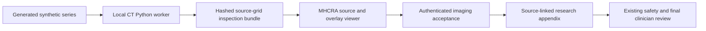

# MHCRA local imaging workbench


The companion [MHCRA AI](https://github.com/LilyC2024/Medical-AI) can inspect a
portable synthetic CT bundle beside its longitudinal history. CT inference stays
in this project's Python 3.12 environment; MHCRA does not install PyTorch or
decode DICOM. The four segmentation classes remain heuristic research outputs.

## Generate a complete synthetic demonstration

After installing this project with the README's CPU and `.[ml,dev]` instructions:

```bash
.venv/bin/python -m deploy.mhcra_bridge --demo \
  --patient-id synthetic-checklist --study-id synthetic-study-001 \
  --output-dir artifacts/mhcra-demo
```

Use a fresh output directory. On Windows replace `.venv/bin/python` with
`.venv\Scripts\python.exe` and run the command on one line. The command generates
20 synthetic 48×48 DICOM slices, prepares pseudo labels, trains a tiny 32×32
12-epoch demonstration model (base width 4) and validates ONNX parity. It exports
`artifacts/mhcra-demo/exchange/bundle.mhcra.zip`. This model demonstrates software
integration, not useful anatomical segmentation or clinical accuracy.

For an existing unchanged generated synthetic series, supply `--series-dir`,
`--checkpoint` and `--onnx-path` instead of `--demo`. The companion
`<series-directory>.synthetic.json` must match every source file. Real DICOM is
unsupported by this bridge, even though the separate research CLI supports
permitted research input. The marker checks provenance within a trusted local
software environment; it is not anonymization or a defence against an operator
who deliberately falsifies synthetic inputs.

## Bundle contract: `mhcra-imaging-v1`

`bundle.json` records explicit patient/study/job identity, a null acquisition date,
processing time, source/model hashes, source geometry, class definitions,
source-grid voxel counts and candidate volumes, postprocessing mode, ONNX parity,
model entropy and hashed relative artifact paths. The ZIP contains that manifest,
the source-grid NPZ mask and source/overlay PNGs for every slice. It contains no
model weights, original DICOM headers or machine-specific paths.

Counts and volumes use the exported source grid, unlike the processed-grid counts
in the legacy deployment report. Teal = class 1, amber = class 2, purple = class 3;
class 0 is transparent and does not establish normality. Previews use a fixed
display window [-200, 1000] HU. Geometry is z,y,x with DICOM LPS physical axes.
The bridge caps inputs at 64 slices and 256 pixels per in-plane dimension.
Postprocessing is disabled explicitly because the recorded baseline showed
worse teacher agreement after postprocessing. Entropy is not clinical confidence.

The receiver must verify the patient association, manifest, paths, file sizes,
hashes, mask classes/counts and preview dimensions before review. A synthetic
marker or a clinician's acceptance does not convert predictions into confirmed
clinical findings. MHCRA requires separate imaging acceptance and final report
approval. The image appendix stays outside the diagnostic hypothesis catalog
and cannot lower MHCRA safety escalation.



See MHCRA's workbench guide for one-button local jobs, cancellation and import.
Generated artifacts stay local and ignored. Public examples must be generated
synthetic illustrations with their limitations displayed.

The published contact sheet was produced from actual generated demonstration
artifacts with `scripts/illustrate_workbench.py --bundle ... --output ...`.
It is a source/overlay inspection example, not evidence of clinical performance.
See [the recorded integration checks](../reports/mhcra_integration.json).
