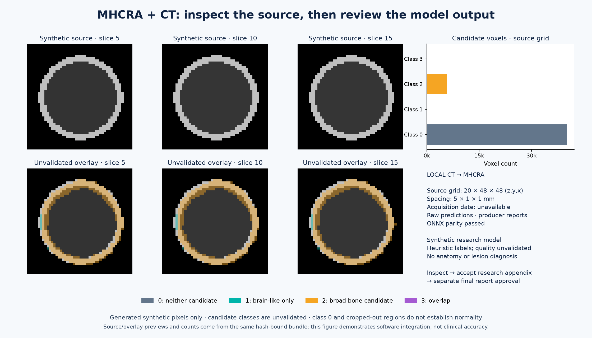

# Legacy tissue-mask connection to LOVISA

[Current nodule integration](lung/mhcra.md) · [Legacy overview](legacy-pipeline.md)

LOVISA is the current name of the former MHCRA AI application. The retained
`mhcra-imaging-v1` bridge supplies synthetic **four-class tissue masks**, separate
from the current nodule-v2 interface.



This figure shows actual generated legacy source/previews, not anatomical ground
truth or lung-nodule accuracy. The demo trains a 32×32/base-width-4 U-Net for 12
epochs and validates ONNX parity. Its small classes/weak teacher agreement limit
interpretation; class 0 is not a normality statement.

```bash
.venv/bin/python -m deploy.mhcra_bridge --demo --patient-id synthetic-checklist --study-id synthetic-legacy --output-dir artifacts/lovisa-legacy
```

Output: `artifacts/lovisa-legacy/exchange/bundle.mhcra.zip`, with source-grid masks,
all-slice previews, geometry, class counts/volumes and hashed provenance. Class
meanings are background, brain-like candidate, broad bone-like candidate and overlap.
Volumes are heuristic candidate voxels, not lesions. Postprocessing is explicitly
disabled; producer parity/execution metadata remains a declaration to the receiver.

LOVISA validates patient/study association and every bounded artifact. Authenticated
imaging acceptance and final clinical-report approval are separate. The appendix
cannot change safety escalation or enter the LLM. Use new immutable study/output
IDs. Never relabel nodule boxes as tissue masks.

[Current LOVISA user guide](https://github.com/LilyC2024/Medical-AI/blob/main/docs/IMAGING.md)
· [Recorded legacy integration](../reports/mhcra_integration.json).
